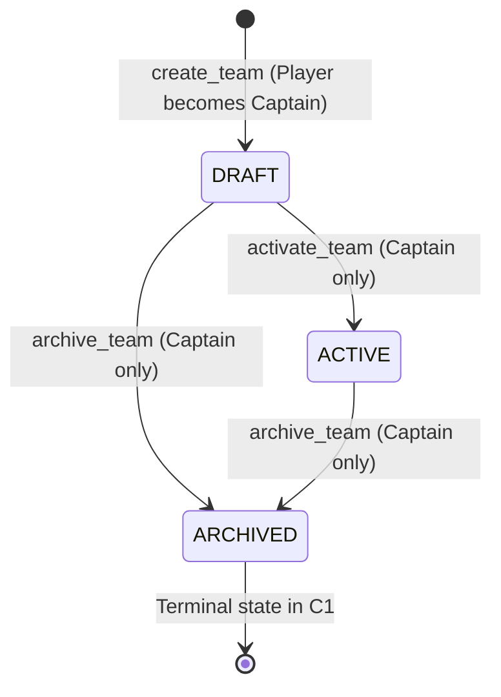

# Phase 4.2 — Account, Team, RBAC và quyết định thiết kế

Tài liệu quyết định cho nhánh `feature/player-auth-rbac`, trên Security Foundation
đã merge (`cb47898`). Quyết định sản phẩm trong yêu cầu B.1 của chủ dự án là nguồn
chính; các đề xuất kỹ thuật bên dưới không có nghĩa API tương ứng đã tồn tại.

## 1. Trạng thái và phạm vi

| Nội dung | Trạng thái |
| --- | --- |
| Official Team vs Team, mỗi Team một bot đại diện | Thiết kế sản phẩm đã duyệt; chưa triển khai |
| Captain/Member, Team sở hữu bot, User là uploader | Thiết kế đã duyệt; B.1 chỉ tạo schema |
| Active Bot theo Team/Game, thay đổi giữa các trận | Thiết kế đã duyệt; chưa thay Active Bot legacy |
| Deadline khóa bot riêng từng Official Match | Thiết kế đã duyệt; chưa có scheduler hoặc bảng match_requests |
| Official không cần Captain online/Accept | Thiết kế đã duyệt; chưa thay workflow invitation |
| Scrimmage tự phục vụ, không cần hai bên online | Định hướng Phase 5; chưa triển khai |
| SQLite version 1, migration có kiểm tra | Đã triển khai B.1, chỉ khởi chạy offline có chủ đích |
| Hash/verify Argon2id, bootstrap Admin offline | Đã triển khai B.1 |
| Account invitation/activation, credential verify, opaque sessions | Đã triển khai B.2 ở service Python độc lập; xem mục 12 |
| SQLite migration v2: idle timeout lưu theo session | Đã triển khai B.2; v1 giữ nguyên, chỉ migrate offline |
| HTTP Account Auth, cookie/CSRF/Origin, limiter thực tế dưới `/api/auth/*` | Đã triển khai B.3.1; feature gate mặc định OFF; xem mục 13 |
| Account-Only policy trên REST/WebSocket đã phân loại | Đã triển khai B.3.2; Team ownership và Official resource policy vẫn khóa chờ C/E |
| Public HTTPS, private Admin qua Tailscale | Chỉ thiết kế; gateway Phase 4.3 |

B.1 **không** tích hợp database vào lifespan FastAPI, không tự tạo Admin khi
khởi động, không đổi `ARENA_ADMIN_CODE`, legacy sessions, upload, lobby, invitation,
Game Adapter, runner, WebSocket, Replay hoặc giao diện. Database mới không cấp
quyền Organizer trong ứng dụng hiện tại. Không được coi B.1 là bản cho phép public
Internet. Giữ nguyên bảo vệ LAN/public-host đang có.

## 2. Hiện trạng có thể tái sử dụng

- `backend/main.py:create_app/lifespan` giữ `WriterLock` trước Store/Sessions và
  Controller claim. Tiếp tục một backend writer/worker cho mỗi data volume.
- `backend/sessions.py:Sessions` lưu participant và hash cookie trong
  `sessions.json`; không phải tài khoản đã xác minh. Organizer hiện dùng mã chung
  `ARENA_ADMIN_CODE` và grant trong bộ nhớ.
- `backend/storage.py:Store` quản lý `bots.json`, `matches.json`, `rules.json`,
  `data/replays`; `uploads` là thư mục ngang cấp `data`. Metadata bot vẫn dùng
  legacy participant trong `owner`.
- `backend/lobby.py:Lobby` dùng `players.json`/`invitations.json`, Active Bot theo
  Player và cần hai Player online/Accept. Đây là workflow legacy, chưa phải Official.
- `backend/matches.py:MatchManager` chạy Bot A/B, lưu snapshot bot, luật và replay.
  Team chỉ là lớp tổ chức phía trên, không đổi luật hoặc JSON Lines của bot.
- Artifacts/image pinning thuộc Controller và volume `arena_artifacts`; account
  database không được chứa runner token, Docker socket hoặc thay quyền Controller.

Không suy luận account/team ownership từ nickname, địa chỉ IP, cookie hoặc tên bot.

## 3. Mô hình dữ liệu B.1 đã triển khai

Database: `<data-dir>/arena.sqlite3`, tương ứng `data/arena.sqlite3` native và
`/app/data/arena.sqlite3` trong volume `arena_data` của Compose. Dùng sqlite3 chuẩn,
không ORM/server. ID entity là text opaque do server tạo; ID Admin dùng UUID ngẫu
nhiên. Timestamps UTC Unix seconds. Không lưu plaintext password hoặc raw token.
Yêu cầu SQLite >= 3.38 (STRICT tables và JSON built-in); từ chối runtime cũ trước
khi tạo database. STRICT cùng CHECK ngăn chuỗi không phải số lọt vào timestamp/
version do quy tắc type affinity của SQLite. Không thay thư viện SQLite trên host.

| Bảng | Khóa và quan hệ chính | Ý nghĩa/constraints đã có |
| --- | --- | --- |
| `schema_migrations` | PK version, UNIQUE name | Checksum SQL, fingerprint schema sau migration, applied_at |
| `users` | PK id, UNIQUE username | Username canonical ASCII 3–32; display name 1–64; ADMIN/PLAYER; INVITED/ACTIVE/DISABLED; ACTIVE cần hash `$argon2id$`; auth_version >= 1 |
| `auth_sessions` | PK id; UNIQUE token_hash; FK user_id | Hash SHA-256 dạng hex 64; audience PLAYER/ADMIN; auth_version, hạn dùng, last_seen, revoked_at |
| `account_tokens` | PK id; UNIQUE token_hash; FK user_id/created_by | ACCOUNT_INVITE/PASSWORD_RESET/LEGACY_CLAIM; hết hạn, consumed/revoked; reset/claim cần target User |
| `teams` | PK id; UNIQUE slug; FK created_by | Slug canonical ASCII 3–48; DRAFT/ACTIVE/ARCHIVED; display name và timestamps |
| `team_memberships` | PK id; FK team_id/user_id | CAPTAIN/MEMBER; joined_at/left_at; UNIQUE active Team/User; tối đa một Captain còn hoạt động mỗi Team |
| `team_invitations` | PK id; FK Team/User/inviter | Invitation thành viên, khác match invitation legacy; một PENDING/Team/User; kết thúc cần responded_at |
| `submission_ownership` | PK bot_id; FK Team/uploader; UNIQUE (team_id, game_id, bot_id) | NEW cần uploader; LEGACY_VERIFIED cho phép uploader không xác định sau xác minh thủ công |
| `team_game_bots` | PK (team_id, game_id); composite FK ownership; FK selected_by | Chỉ tham chiếu bot thuộc đúng Team và Game; selected_at, revision >= 1 |
| `audit_events` | PK integer id; FK actor nullable | action, target, occurred_at và details_json hợp lệ; bootstrap ghi một sự kiện cùng transaction |

FK dùng `ON DELETE RESTRICT`: không cascade xóa tài khoản/đội/bot hoặc làm mất
chứng cứ. Dùng disable/archive/revoke trong các service tương lai. Index trên
sessions theo User/expiry, invitations PENDING và audit theo thời gian.

Trigger chặn ADMIN tham gia Team đang hoạt động và chặn nâng User đang có active
membership lên ADMIN. Muốn đổi system role phải kết thúc membership có kiểm soát.
ADMIN không tự động trở thành Captain hoặc sở hữu bot của các Team.

### Những ràng buộc không thể thay thế domain service

- SQL bảo đảm **tối đa một** active Captain. Điều kiện **đúng một Captain** khi
  Team đủ điều kiện thi đấu, chuyển Captain nguyên tử, cấm mất Captain cuối cùng
  phải được service B.2/C thực thi trong transaction trước khi có Team endpoints.
- B.1 chưa chốt một User được thuộc bao nhiêu Team trên toàn hệ thống. Schema
  chỉ cấm hai membership đang hoạt động trùng Team/User; eligibility theo giải
  sẽ được chốt trước khi mở Team APIs.
- FK uploader/selected_by chứng minh User tồn tại; chưa chứng minh đang thuộc
  Team hoặc là Captain. SQL audience không thay thế kiểm tra system role khi login.
- `bot_id` trỏ vào JSON bên ngoài, `game_id` trỏ GameRegistry: không có FK giả
  sang file JSON. Composite FK chỉ bảo đảm **binding SQL** đúng Team/Game. Ready
  compile status, source/artifact digest, membership và registry cần service kiểm tra.
- B.1 chưa có auto claim legacy, CRUD Team, session/token issuer hay public serializer.
  `audit_events` không phải sổ chống sửa bởi operator có quyền ghi database.

## 4. Migration và single writer đã triển khai

`backend/account_schema.py` chứa migration 1 bất biến sau khi release.
`backend/account_database.py:AccountDatabase` chỉ tính đường dẫn trong constructor;
import hoặc chạy backend hiện tại không tạo database.

`maintenance()` lấy `WriterLock(data_dir)` **trước cả mở/tạo SQLite**, giữ đến khi
connection đóng. Đây chính là `data/.writer.lock` mà backend giữ suốt lifespan:
bootstrap và backend không thể ghi đồng thời. Không xóa lock file để thử lại;
OS nhả lock khi process thoát. Chỉ hỗ trợ local filesystem/Docker named volume,
không dùng NFS/SMB hay nhiều backend replicas.

Mỗi connection bật `foreign_keys=ON`, busy timeout 5 giây, `synchronous=FULL`.
B.1 dùng DELETE journal mặc định, từ chối WAL để không tự thay đổi journal mode.
Database mới được tạo với mode 0600 trên POSIX; Windows kế thừa ACL của data dir.
Không tự chmod file có sẵn hoặc thay ACL/secret trên máy operator.

Migration chạy `BEGIN IMMEDIATE`, từng SQL statement, version ledger,
`PRAGMA user_version` và `application_id` trong cùng transaction; lỗi rollback
cả DDL và version. Không dùng `executescript()` gây implicit commit.

Kiểm tra version/identity, checksum migration, fingerprint catalog tables/indexes/
triggers và `integrity_check` **cùng** `foreign_key_check`. Từ chối DB lạ không có
version nhưng đã có bảng, version mới hơn, ledger lệch, schema bị sửa hoặc dữ liệu
FK hỏng. Không reset/xóa/import dữ liệu để sửa lỗi. `check` mở mode=ro, không tự
khởi tạo DB thiếu. Fingerprint là phát hiện thay đổi/incompatibility, không phải
chữ ký chống operator ác ý.

Thêm migration mới, không chỉnh lại migration đã dùng. B.3 khi tích hợp FastAPI
phải tái sử dụng lifespan WriterLock đã giữ; **không** gọi `maintenance()` lồng
trong lifespan vì đó là một writer thứ hai. Không auto migrate production ngầm.

## 5. Admin bootstrap offline B.1

Dependency mới duy nhất: `argon2-cffi>=25.1,<26`. Hash Argon2id v19 với 64 MiB,
3 iterations, 4 lanes, salt 16 bytes ngẫu nhiên, output 32 bytes. Đây là profile
RFC 9106 low-memory của [argon2-cffi](https://argon2-cffi.readthedocs.io/en/stable/api.html).
Password mới tối thiểu 15 ký tự, tối đa 1024 UTF-8 bytes; không ép mẫu ký tự,
không cắt hoặc strip password. Hash và verify trong `backend/passwords.py`; có
`needs_rehash` cho luồng login tương lai.

CLI `python -m backend.admin_cli` bắt buộc `--data-dir` rõ ràng, không có password
argument/default/env fallback. `create-admin` chỉ đọc hai lần bằng `getpass` trong
terminal tương tác, từ chối pipe và fallback echo. WriterLock được giữ trước prompt.
Không log/return hash hoặc password. Python không bảo đảm xóa mọi bản sao password
trong RAM; terminal/host/operator vẫn phải đáng tin cậy.

Username normalize lowercase; nếu trùng bất kỳ User nào thì từ chối, không reset
password, promote Player hoặc tạo thêm bản ghi trùng. Cho phép nhiều Admin **khác
username** nếu operator chủ động tạo; không ép cả hệ thống chỉ một Admin. Insert
User ACTIVE/ADMIN và audit `OFFLINE_ADMIN_CREATED` cùng transaction; lỗi audit
rollback User. Không tạo auth_session/cấp quyền web.

### Chạy native sau khi review (không tự chạy trên dữ liệu thật)

Dừng backend dùng đúng data directory trước. Không có password trong các lệnh:

```powershell
.\.venv\Scripts\python.exe -m pip install -r requirements.txt
.\.venv\Scripts\python.exe -m backend.admin_cli --data-dir .\data migrate
.\.venv\Scripts\python.exe -m backend.admin_cli --data-dir .\data create-admin --username arena.admin --display-name "Arena Admin"
.\.venv\Scripts\python.exe -m backend.admin_cli --data-dir .\data check
```

Linux thay executable bằng `python3`. Có thể thử trên thư mục QA riêng bằng cách
thay `--data-dir` (không mount dataset production). `migrate` không tạo tài khoản;
`check` không đòi password. Exit code 0 thành công; 1 bị từ chối/lỗi; argparse 2
cho tham số sai. Nếu backend đang chạy, bootstrap bị chặn chứ không can thiệp trận.

Image backend đã COPY toàn bộ `backend/` và cài `requirements.txt`; không cần đổi
Dockerfile hoặc sandbox. Sau này operator có thể rebuild và chạy CLI one-off với
service backend đã stop, cùng volume `/app/data`. Chưa chạy Docker QA B.1; không
coi các hướng dẫn này là chứng nhận đã bootstrap trên Docker hoặc AWS.

## 6. Target authentication/session — phân biệt core, HTTP và cutover

Service core B.2 được mô tả ở mục 12. HTTP foundation B.3.1 trong mục 13 chỉ áp
dụng namespace `/api/auth/*`; WS/cutover toàn API và gateway dưới đây còn là thiết kế.

- Tài khoản cá nhân ADMIN/PLAYER. Không đăng ký tự do; Admin cấp account invitation
  một lần, server chỉ lưu hash token; expiry, consumed_at/revoked_at được kiểm tra
  và consume nguyên tử. Không gửi password qua invitation.
- Admin ban đầu bằng CLI; thêm/reset/disable Admin về sau là hành động riêng có
  audit. Chuyển khỏi `ARENA_ADMIN_CODE` có giai đoạn rõ ràng, không cấp hai cơ chế
  quyền song song trên deployment public cuối cùng.
- Session opaque CSPRNG, chỉ SHA-256 hash lưu DB; rotate khi login/nâng quyền,
  expiration tuyệt đối và idle timeout, logout revoke. Đổi password/disable User
  tăng auth_version và revoke sessions; so sánh version mỗi request.
- Player/Admin dùng session audience tách biệt; Admin chỉ qua private gateway và
  phải có system_role ADMIN. Public gateway không được mở Admin action kể cả khi
  cookie ADMIN hợp lệ. Phase 4.3 enforce host/path/method allowlist và proxy trust.
- Cookie Secure/HttpOnly/SameSite, host-only; tên cookie tách biệt public/private.
  Origin exact allowlist + CSRF token cho mutating requests; WS xác thực cookie,
  Origin, audience và quyền trước accept; kiểm tra expiry/revocation khi reconnect
  và khi đang kết nối. Không đặt session/token trong URL hoặc localStorage.
- Rate limit login theo account + nguồn tin cậy, giới hạn hash concurrency vì
  mỗi Argon2 dùng 64 MiB. Generic authentication errors, không log password/hash,
  không lộ có/không username qua public endpoints.

TTL service đã có mặc định đề xuất, xem mục 12; cookie policy, rate-limit cụ thể
và recovery còn cần review trước deployment. Không suy ra toàn bộ REST/WS đã được bảo vệ.

## 7. Team/Bot ownership và RBAC dự kiến

Các quyền dưới đây là **target design**, chưa được gắn vào REST/WS trong B.1.

| Hành động | ADMIN | CAPTAIN (PLAYER) | MEMBER (PLAYER) |
| --- | --- | --- | --- |
| Mời/disable account, quản lý cuộc thi/luật | Có qua private gateway | Không | Không |
| Tạo/quản lý Team | Điều phối/can thiệp có audit | Team của mình, theo chính sách đăng ký | Không quản trị |
| Mời/loại Member, chuyển Captain | Can thiệp có audit | Chỉ Team của mình; không làm mất Captain | Không |
| Nộp phiên bản bot/xem source, compile log | Chỉ khi được quyền vận hành có audit | Team của mình | Team của mình |
| Chọn Active Bot theo Team/Game | Không tự coi Admin là Captain | Có, bot ready của Team | Không |
| Lên lịch/khóa/hủy Official Match | Có | Không | Không |
| Live/Replay/metadata public được cho phép | Có | Có | Có |
| Scrimmage tự phục vụ | Chính sách Phase 5 | Tương lai | Tương lai, cần chốt quyền |

Mọi kiểm tra ownership dựa User/session -> membership server -> Team -> binding,
không tin team_id/uploader/role do client gửi. Source/compile logs chỉ Team đó
hoặc Admin được ủy quyền; replay public không mang execution path/token/hash auth.

Upload tương lai có bước staging immutable source/artifact, compile như hiện tại,
đăng ký ownership và publish metadata có recovery idempotent. Không thể transaction
nguyên tử giữa SQLite và JSON: cần submission operation ID/trạng thái pending trong
migration tiếp theo hoặc journal reconciliation trước khi mở API. Bot chưa hoàn
tất publish hoặc compile lỗi không thể Active/Official. B.1 chưa làm flow này.

## 8. Official Match/per-match locking — chỉ thiết kế

**Không có bảng/scheduler Official Match trong migration 1.** Đề xuất migration sau:

| Entity | Metadata dự kiến |
| --- | --- |
| `match_requests` | id, kind=OFFICIAL (SCRIMMAGE về sau), created_by Admin, team_a_id/team_b_id khác nhau, game_id, rules_snapshot, bot_lock_at UTC, scheduled_at, status, revision, deterministic match_id, created_at/locked_at, failure_code |
| `match_request_slots` | PK (request_id, side A/B), Team ID và snapshot tên Team, frozen_submission_id, uploader snapshot nếu cần, bot name/language, source/artifact digest, pinned image ID, locked_at, active_bot_revision |
| `match_execution_link` (nếu cần) | request_id UNIQUE -> existing match_id UNIQUE, trạng thái dispatch/recovery; không đưa credential runner vào public data |

Tên bảng/field cụ thể được review trước migration thực tế. Rules snapshot theo
request được chốt khi Admin lên lịch từ cấu hình hợp lệ; bot snapshot chốt ở
deadline riêng. Không dùng rules/game đang chọn hiện tại để ghi đè trận đã tạo.

### Deadline và tính đúng đắn

1. Admin chọn Team A/B, game, luật, lịch chạy và **bot_lock_at riêng từng trận**.
   Kiểm tra deadline không sau thời điểm bắt đầu. Lưu request revision/idempotency;
   chưa cần Captain online và không sinh lời mời bắt buộc Accept.
2. Trước deadline, Captain được đổi Active Bot của Team/Game cho các trận chưa khóa.
   Mỗi lần đổi tăng revision. Bản source/artifact đã publish là immutable, không
   cho sửa byte dưới cùng submission ID để né deadline.
3. Tại deadline, server transaction chọn bot ready của mỗi Team từ Active Bot,
   ghi snapshot đầy đủ cả hai slot và chuyển request LOCKED bằng compare-and-set
   revision/status. Không lấy bot_id do frontend gửi tại lúc chạy.
4. Để chống tick chậm/restart: **xử lý mọi deadline đã đến trước khi nhận thay đổi
   Active Bot**, cả trong startup recovery và transaction chọn bot. Single backend
   không nhận mutation khi offline; snapshot dùng lựa chọn trước deadline, không
   lấy lựa chọn mới sau deadline. Server UTC là nguồn thời gian; monitor clock.
5. Thiếu bot/compile lỗi/artifact thiếu khi khóa => BLOCKED rõ lý do, không tự xử
   thua hoặc chọn bot nộp sau deadline. Admin review/cancel/reschedule request mới
   có audit. Chính sách xử thua/no-show cần duyệt riêng trước vận hành Official.
6. Thay Active Bot sau deadline ảnh hưởng các trận tương lai, không sửa slot LOCKED.
   Không unlock và ghi đè lịch sử âm thầm. Team rename/membership change cũng không
   đổi snapshot trận đã khóa.

Deadline được xử lý không phụ thuộc presence/Accept. Scheduler cần recovery bền
vững và kiểm tra deadline dưới cùng serialized transaction với việc chọn bot;
không dựa timer frontend. Đây là yêu cầu cho D/E, **chưa được chứng minh bởi B.1**.

### Tương thích MatchManager và JSON Replay

Lớp điều phối mới nạp hai frozen submissions, truyền Bot A/B và rules snapshot vào
MatchManager hiện tại, kèm Team metadata ở lớp lịch sử/serializer. GameAdapter vẫn
nhận A/B, không biết account/Team/tournament. Runtime container suốt trận và JSON
Lines giữ nguyên; kết quả bot/hạ tầng vẫn phân biệt như hiện tại.

Persist deterministic match_id/link trước dispatch, đối chiếu JSON khi recovery;
crash giữa SQLite và JSON không được tạo trận thứ hai. Chưa có distributed queue
hoặc replica. Replay dùng game_id/rules của chính trận, bảo toàn mọi JSON/JSONL cũ.
Workflow legacy invitation giữ nguyên trong B.1; bước chuyển đổi sẽ có compatibility
flag/endpoint rõ ràng, không biến invitation cũ thành Official ngầm.

Scrimmage Phase 5 dùng bot đại diện được snapshot khi request, kiểm tra quyền/quota,
không đòi hai bên online. Không tái sử dụng điều kiện hai Accept của lobby legacy.
Tournament/Season là lớp tổ chức tương lai, không thêm bảng rỗng trong B.1.

## 9. Legacy migration, backup và rollback

B.1 không đọc `sessions.json` để tạo users/teams/bindings. Database mới có các bảng
trống trừ Admin được operator tạo rõ ràng và audit đi kèm. Bots, artifacts,
invitations, luật, match history và replay không bị đổi tên/xóa/ghi lại.

Migration ownership tương lai phải backup trước, inventory read-only, lập manifest
legacy participant -> account/Team **đã xác minh**. Bot không xác minh giữ unclaimed,
không chọn thi đấu Official. Lưu uploader không xác định là NULL với origin
LEGACY_VERIFIED khi có quyết định xác minh; không bịa attribution. Claim có audit,
dry-run, checksum, resumable mapping và không sửa frame replay. Không bao giờ fallback
sang legacy owner khi binding account thiếu.

Runbook cold backup Security Foundation vẫn dừng backend/Controller, đồng bộ ba
volumes `arena_data`, `arena_uploads`, `arena_artifacts` cùng exact images/digests.
Snapshot generic tự bao gồm `arena.sqlite3` trong data; operator phải dừng cả CLI
maintenance, để mọi SQLite connection đóng và không bỏ journal có giao dịch đang
phục hồi. Không copy riêng database đang ghi hoặc dùng SQLite backup đơn lẻ để
coi JSON/artifacts đã đồng bộ. Không xóa journal/WAL để "sửa" DB.

B.1 kiểm thử cold snapshot/restore **thư mục tạm** chứa SQLite bằng helper hiện
có, không chạy Docker volumes thật. Trước deployment authentication cần nâng manifest lưu DB schema/version,
kiểm tra integrity/FK và cross-store reconciliation sau restore, cùng policy revoke
sessions/tokens sau phục hồi trước khi mở login. Chưa tự thêm các bước đó vào
production backup script trong B.1. Nếu chuyển WAL sau này phải cập nhật runbook
và kiểm thử checkpoint/sidecar, không chỉ đổi pragma.

Rollback B.1: stop writers, backup cả ba volumes; chạy image/code cũ (không đọc
SQLite) vẫn dùng nguyên JSON/replay, giữ nguyên DB mới để review hoặc upgrade lại.
Không drop bảng/xóa database để rollback; không chạy down -v. Khi B.2 bắt đầu ghi
ownership/session thực tế, rollback phải review mapping và authorization; không
coi rollback code đơn thuần là phục hồi quan hệ đã thay đổi.

## 10. Thứ tự B.2–E và tiêu chí review

1. **B.1 (đã hoàn thành):** schema/migration, password primitives, offline Admin và test
   cách ly; review code và doc trước mọi tích hợp runtime.
2. **B.2 (lượt này):** Account/Invitation/Authentication/Session core độc lập,
   connection DI, Argon2 concurrency và contract rate limiting; chưa HTTP integration.
   **B.3 (chưa làm):** dependency HTTP authentication, cookies/CSRF/Origin,
   limiter thực tế, API/WS revocation; explicit offline migration và dùng lại
   WriterLock backend; chưa public Internet.
3. **C:** Team lifecycle/RBAC, bảo đảm Captain, Team invitation, immutable submission
   ownership và active bot theo game; cross-store recovery + IDOR/role tests.
4. **D:** match_requests/deadline/frozen slots, Official điều phối qua MatchManager,
   deterministic dispatch/restart, bot-lock race tests, legacy invitation transition.
5. **E:** frontend integration/WS auth/revocation, legacy verified migration runbook,
   backup/restore SQLite + JSON + artifacts, regression hai game/ba ngôn ngữ; rồi
   mới Phase 4.3 private/public gateway và security acceptance Internet.
6. **Phase 5:** self-service offline Scrimmage, quota, Tournament/Season theo nhu cầu.

Test B.1 dùng `tmp_path`, không tác động data/volumes thật:

```powershell
.\.venv\Scripts\python.exe -m pytest tests/test_account_database.py tests/test_admin_bootstrap.py -ra --tb=short
.\.venv\Scripts\python.exe -m pytest tests controller_tests -ra --tb=short
```

Kiểm tra schema mới, migration idempotent/reject/rollback, FK/uniqueness, session/
token constraints, Argon2id/random salt, bootstrap duplicate/atomic audit/hidden
prompt, cross-process lock, reopen/persistence/integrity và bảo toàn JSON/Replay.
Kết quả thực thi được báo riêng; không suy ra Docker/AWS hoặc HTTP login đã PASS.

Các quyết định còn lại trước API: eligibility một User/nhiều Team, ai được tạo
Team, account invitation lifetime, recovery/reset policy, TTL sessions, Captain
transfer, no-bot tại deadline và quyền Scrimmage. Các quyết định đã duyệt ở đầu
tài liệu không cần xin duyệt lại.

## 11. Kết quả kiểm chứng B.1 trên local

Môi trường thực chạy: Windows, Python 3.13.12, SQLite 3.51.1, argon2-cffi 25.1.0.
Tất cả account tests sử dụng thư mục tạm; không tạo `data/arena.sqlite3` hoặc Admin
trong dataset thực của repository.

| Lệnh/nhóm kiểm tra | Kết quả thực tế |
| --- | --- |
| `python -m pytest tests/test_account_database.py tests/test_admin_bootstrap.py -ra --tb=short` | **44 PASS**, 0 FAIL, 0 SKIP |
| `python -m pytest tests controller_tests -ra --tb=short` (lần cuối sau STRICT) | **245 PASS**, 0 FAIL, 0 SKIP, 65.07 giây |
| `python -m pip check` | PASS, không có dependency hỏng |
| `python -m backend.admin_cli --help` | PASS, có migrate/check/create-admin; không có password option |

Suite đầy đủ bao gồm regression cũ của Robot Battle/OTT v2, Python/C++/Java native,
invitation/lobby/WebSocket/Replay, writer lock, controller protocol/lifecycle và
backup helper. Controller tests dùng môi trường test/doubles hiện có; không phải
kiểm chứng Docker Engine thật ở lượt B.1. Có một StarletteDeprecationWarning về
httpx/TestClient; không thay dependency ngoài phạm vi để xử lý cảnh báo này.

Đã thực chạy cold snapshot/restore qua helper hiện có trên **thư mục tạm**, kiểm
tra byte database/replay, verify hash sau reopen, integrity và foreign keys. Prompt
ẩn được test tự động bằng terminal/getpass doubles; chưa tạo Admin bằng cách gõ
password thật trong terminal. Chưa chạy Docker/Linux QA hoặc tác động AWS/volumes.

Chưa chứng nhận HTTP authentication/RBAC, Team lifecycle, scheduler/deadline thực
tế hoặc public access: những chức năng đó chưa được triển khai trong B.1.

## 12. B.2 — Authentication Service Core đã triển khai

B.2 dựa commit B.1 `580dd6ef0187e662859ecaa5509ecc52db9a95e9`. Chỉ thêm service
Python và tests, không tạo HTTP endpoints, middleware, frontend Login, Team CRUD,
password reset HTTP hoặc public gateway. `backend/main.py`, `sessions.py`,
NetworkSettings, ARENA_ADMIN_CODE, MatchManager, GameAdapter và Sandbox giữ nguyên.
DB tại data directory thật không được khởi tạo/migrate trong lượt kiểm thử này.

### 12.1 Account và invitation lifecycle

`backend/auth_service.py:AuthService` làm việc trên schema đã migrate:

- `get_account(id)` / `get_account_by_username(username)` trả Account whitelist
  gồm id, username, display_name, system_role, status, auth_version; không trả hash.
  Đây là internal API, không phải public account lookup/enumeration endpoint.
- `issue_invitation(admin_actor, username, name?, ttl_seconds?)` kiểm tra Admin
  session còn hợp lệ **trong transaction**, reserve username canonical và tạo
  User **PLAYER/INVITED** với ID ngẫu nhiên do server sinh. Không có role/status/
  acting-user-ID argument cho người đăng ký. Username đã tồn tại, kể cả INVITED,
  bị từ chối; không promote hoặc overwrite User cũ.
- Token 32 random bytes CSPRNG, encode base64url 43 ký tự; chỉ hash SHA-256 lưu
  `account_tokens`. Token chỉ trả khi cấp mới trong InvitationGrant; repr ẩn token.
  Invitation được bind sẵn vào User/username, không phải vé self-registration tự do.
- `activate(token, password)` chỉ nhận bearer invitation và password. Kiểm tra
  purpose ACCOUNT_INVITE, thời hạn, consumed/revoked và target PLAYER/INVITED trước
  hash, rồi kiểm tra lại sau hash trong `BEGIN IMMEDIATE`. Consume token, đổi User
  sang ACTIVE, ghi Argon2id, tăng auth_version và audit **cùng transaction**. Không
  cấp session tự động. Hai activation cùng token chỉ một bên thắng.
- `revoke_invitation(admin_actor, invitation_id)` revoke idempotent, không xóa
  lịch sử. `reissue_invitation(admin_actor, invited_user_id)` chỉ cho PLAYER đang
  INVITED; thu hồi mọi invitation cũ chưa dùng và cấp token mới nguyên tử, giữ
  nguyên ID/username. ACTIVE/DISABLED/Admin không được dùng flow này.
- `disable_account(admin_actor, target_user_id)` chuyển INVITED/ACTIVE -> DISABLED,
  tăng auth_version, revoke sessions và các account tokens chưa consume, ghi audit
  cùng transaction. Lặp disable trả false, không tạo bản ghi User mới.

Account lifecycle B.2: INVITED -> ACTIVE qua activation, INVITED/ACTIVE -> DISABLED
qua Admin. Không có tự đăng ký, Admin registration, re-enable, đổi system role,
reset password hoặc ownership migration. Admin vẫn bootstrap offline bằng CLI.
Invitation expired được xác định bằng expires_at, không cần scheduler cập nhật
status. Reissue là cách cấp lại cho User INVITED khi token cũ hết hạn/bị revoke.

### 12.2 Contract actor và authorization

Admin mutations nhận **Principal đã được server tạo từ login/validate_session**.
Principal là context nội bộ frozen, có marker trong process, không deserialize
từ JSON, không serialize nguyên object ra HTTP và không giữ qua restart. Marker
không phải chữ ký mật mã hay security boundary chống code Python trong backend;
backend process/SQLite writer là thành phần đáng tin cậy.

Service không tin claimed role/status/user ID: mỗi mutation query lại session và
User trong transaction, kiểm tra audience, ACTIVE, role thực, auth_version,
revocation, absolute/idle expiry và User ID khớp. Đổi role trong DTO, truyền dict
`{"role":"ADMIN"}` hoặc dựng Principal từ field client không cấp quyền. Principal
đã revoke/expire cũng không thể tiếp tục quản trị. Quyền Admin không vượt qua
Team RBAC, vì Team APIs chưa được triển khai.

`revoke_all(actor, user_id?)` cho phép User thu hồi tất cả sessions của chính mình,
Admin được thu hồi User khác. Thao tác tăng auth_version và revoke các hàng session
chưa revoke cùng audit; principal đang dùng cũng mất hiệu lực khi revoke chính nó.

### 12.3 Credential verification và giới hạn password work

`login(username, password, audience, source_key)` chuẩn hóa username, gọi limiter,
verify qua `backend/passwords.py`. Unknown username, sai password, INVITED,
DISABLED và sai audience đều là `AuthenticationFailed("Invalid credentials")`.
Account không đủ điều kiện dùng dummy Argon2 hash để giảm khác biệt thời gian;
không tuyên bố constant-time tuyệt đối. Hash malformed trả authentication failure;
lỗi SQLite/capacity là lỗi hạ tầng, không giả làm password sai.

Argon2 chạy **ngoài transaction**. Sau verify, transaction đọc lại status, role,
password_hash và auth_version so với snapshot; disable/revoke-all/credential update
trong lúc hash khiến login bị từ chối, không sinh session dựa dữ liệu cũ.
Activation cũng recheck token/status/version và expiry sau hash. Hash/verify không
ghi/log plaintext password và không thêm dependency ngoài B.1.

`PasswordWorkLimiter` dùng semaphore dùng chung toàn process, mặc định tối đa **1**
Argon2 work cùng lúc; không tạo hàng đợi không giới hạn. Quá capacity trả
AuthenticationBusy. Có thể inject limiter dùng chung khác khi operator review
RAM/CPU; không tạo limiter riêng cho từng request để lách giới hạn. Dummy hash
khởi tạo lazy một lần ngoài transaction; import module không tính hash/khởi tạo DB.
Chưa tự rehash/đổi password sau login; `needs_rehash` B.1 vẫn sẵn cho flow sau này.

**Rate-limit contract, chưa phải HTTP rate limiter:** constructor bắt buộc inject
LoginLimiter, không có allow-all default. `check(LoginAttempt)` trước verify có thể
từ chối bằng AuthenticationBusy; `record(attempt, succeeded=...)` nhận kết quả,
không được raise. Attempt chỉ có hash username canonical, audience và source key;
không có password/raw token/token hash. Source key do trusted server/proxy adapter
ở B.3 xác định, không lấy X-Forwarded-For không tin cậy hoặc field client tự nhận.
Rate-limit cụ thể theo account + source, bảo vệ activation và mapping HTTP errors
còn phải triển khai B.3. Test dùng limiter double được chỉ định rõ ràng.

Generic errors, session expiration và server-side invalidation được đối chiếu
với [OWASP Authentication](https://cheatsheetseries.owasp.org/cheatsheets/Authentication_Cheat_Sheet.html)
và [OWASP Session Management](https://cheatsheetseries.owasp.org/cheatsheets/Session_Management_Cheat_Sheet.html).
Các nguồn này không phải bằng chứng ứng dụng đã public an toàn.

### 12.4 Opaque session, TTL và revocation

Session token độc lập mỗi login: 32 random bytes, không JWT. SQLite chỉ lưu SHA-256
token hash và ID User ổn định. SessionGrant chỉ trả raw token ở thời điểm tạo;
repr ẩn token. Không log grant bằng asdict hoặc đưa token/hash vào audit. HTTP B.3
phải chuyển token vào cookie bảo vệ, không URL/localStorage/response logging.

| Audience | System role bắt buộc | Absolute TTL đề xuất | Idle TTL đề xuất |
| --- | --- | --- | --- |
| PLAYER | PLAYER | 8 giờ | 60 phút |
| ADMIN | ADMIN | 4 giờ | 15 phút |

Đây là **mặc định để review**, không phải cấu hình production được nghiệm thu.
AuthPolicy/SessionTTL inject được, TTL nguyên dương và idle không quá absolute.
Mỗi TTL được giới hạn từ 1 giây đến 365 ngày để từ chối cấu hình vô hạn/sai kiểu.
Invitation TTL mặc định đề xuất 24 giờ, có override khi Admin cấp, cũng cần review.

Absolute expiry và idle_timeout_seconds được lưu theo **từng session**. Đổi cấu
hình/reopen không tự kéo dài session cũ. `validate_session(token, audience, touch)`
kiểm tra session/User/audience/auth_version/revoked_at, `now < expires_at` và
`now < last_seen_at + idle_timeout_seconds`; fallback last_seen là created_at.
Đúng boundary là hết hạn. Touch mặc định cập nhật last_seen; touch=false không
kéo dài idle, không có sliding absolute expiry. Mutation có actor hợp lệ cũng
ghi nhận hoạt động trong cùng transaction. Đồng hồ quay ngược trước created/last
seen bị từ chối; vận hành cần server UTC ổn định.

`logout(token, audience)` revoke đúng token/audience trong DB và audit nguyên tử,
idempotent; token không tồn tại/đã revoke trả false. Token hết hạn vẫn có thể được
thu hồi, không cấp lại quyền. `revoke_all` và `disable_account` làm session cũ
mất hiệu lực cả khi caller còn giữ Principal snapshot. B.3/password reset tương
lai bắt buộc tăng auth_version và revoke sessions trong cùng credential-change
transaction; B.2 không cung cấp raw update password endpoint.

### 12.5 Append-only migration v2

Không sửa SQL/checksum migration v1 `account_foundation` đã commit. Migration 2
`auth_service_core` thêm `auth_sessions.idle_timeout_seconds` NOT NULL > 0. Default
1 giây chỉ là fallback an toàn cho raw/manual insert; service luôn ghi TTL cụ thể.

B.1 chưa có session issuer; các hàng SQL tạo thủ công trước service không có idle
policy được phê duyệt nên v2 **đánh dấu revoke**, giữ nguyên hàng, và điền last_seen
thiếu bằng created_at. Không revoke/xóa `sessions.json` của browser legacy, không
sửa User/password/ownership/Team/JSON/Replay/artifacts. Migration dùng cơ chế atomic
version/checksum/fingerprint/integrity/FK B.1; chỉ chạy offline có chủ đích.

Runtime service từ chối DB v1 hoặc DB thiếu, không tự migrate/create. Chưa chạy
migration trên dataset thật/volumes/AWS. CLI migrate/check hiện hỗ trợ v2. Trước
triển khai sau review phải cold backup đầy đủ, dừng writer, migrate offline đúng
volume rồi check; không dùng down -v hoặc downgrade user_version thủ công. Code
B.1 cũ sẽ từ chối DB v2; rollback DB cần bản backup, còn backend legacy chưa đọc
SQLite vẫn hoạt động như cũ và không được xóa DB để giả làm rollback.

### 12.6 SQLite ownership, transaction và boundary B.3

`AccountDatabase.writer_connection(writer_lock)` mượn lock đã giữ, mở mode=rw với
DB **đã tồn tại**, validate version/FK/journal/synchronous/integrity rồi yield
connection. Không lấy WriterLock thứ hai, không gọi maintenance, không tự migrate.
AuthService nhận connection + writer_lock; constructor kiểm tra đúng data dir,
active lock, explicit transactions, schema/version và pragmas. Mỗi operation
kiểm tra lock còn giữ, không cho caller bọc transaction bên ngoài; FK phải bật.

Connection do caller sở hữu: service không đóng connection, không giữ lease riêng.
Mỗi connection được tạo/dùng/đóng trong cùng thread. Nhiều connection **trong cùng
backend đang sở hữu một WriterLock** có thể dùng BEGIN IMMEDIATE để serialize
transaction ngắn; không phải cho phép nhiều process writer. Không dùng chung
connection qua concurrent threads hoặc `check_same_thread=False` rồi bỏ khóa.

Ví dụ boundary cho B.3, **chưa gắn vào FastAPI hiện tại**:

```python
# Schema phải được migrate offline trước; code dưới không tự khởi tạo.
with WriterLock(data_dir) as writer:  # backend lifespan đã có lock này
    # Trong synchronous worker, toàn bộ open/use/close cùng thread:
    with AccountDatabase(data_dir).writer_connection(writer) as connection:
        auth = AuthService(connection, writer, login_limiter=server_limiter)
        # Principal lấy từ auth.validate_session(cookie_token, audience=...)
        # rồi chuyển trực tiếp cho mutation; không parse Principal từ request.
```

B.3 cần truyền outer writer từ lifespan, tạo/đóng connection trong worker sở hữu
nó, đợi công việc hoàn tất trước khi nhả lock. Giữ shared password limiter toàn
process và dùng limiter HTTP thực. DB/schema lỗi phải fail closed, không fallback
về legacy để cấp account permission. Những thao tác lõi không đổi JSON storage;
chưa có transaction xuyên SQLite/JSON hoặc Team ownership migration.

### 12.7 Kiểm thử và phần còn lại

Tests mới ở `tests/test_auth_service.py` chỉ dùng tmp_path, clock inject và các
limiter double rõ ràng. Expiration/race dùng clock/barrier, không sleep để chờ TTL.
Kiểm tra activate cạnh tranh trên hai connection, actor giả/stale, audience,
idle/absolute expiry, revoke/disable/version, không lưu/log raw secrets, rollback
audit lỗi, migration v1 -> v2 giữ User/ledger v1 và bảo toàn JSON/replay. Có test
import/construct app không mở SQLite và service không tạo DB thiếu, không dùng
được sau unlock hoặc lồng transaction của caller.

```powershell
.\.venv\Scripts\python.exe -m pytest tests/test_auth_service.py -ra --tb=short
.\.venv\Scripts\python.exe -m pytest tests/test_account_database.py tests/test_admin_bootstrap.py -ra --tb=short
.\.venv\Scripts\python.exe -m pytest tests controller_tests -ra --tb=short
.\.venv\Scripts\python.exe -m pip check
```

Giới hạn B.2: chưa có HTTP/cookie/CSRF/Origin/WS auth, limiter HTTP thực, account
recovery/reset/re-enable, Team RBAC, xử lý session restore sau backup hoặc gateway.
Không được đưa service ra Internet chỉ vì unit tests PASS. Không thay bảo vệ
LAN/public-host hiện có. B.3 đề xuất chỉ tích hợp HTTP authentication có kiểm soát,
cookie/CSRF/Origin, real rate limiting, dependency session và tests REST/WS, cùng
review chuyển đổi legacy quyền rõ ràng; chưa Team/Official/Scrimmage hoặc public
deployment. Dừng review B.2 trước khi triển khai B.3.

### 12.8 Kết quả kiểm chứng B.2 thực tế

Chạy native Windows, Python 3.13.12/SQLite 3.51.1/argon2-cffi 25.1.0, dữ liệu tạm:

| Lệnh/kiểm tra | Kết quả |
| --- | --- |
| `python -m pytest tests/test_account_database.py tests/test_admin_bootstrap.py -ra --tb=short` | **44 PASS**, 0 FAIL, 0 SKIP, sau migration v2 |
| Nhóm account + bootstrap + auth service trong lượt kiểm thử liên quan | **98 PASS** (54 test mới B.2 + 44 B.1) |
| `python -m pytest tests controller_tests -ra --tb=short` trên code cuối | **299 PASS**, 0 FAIL, 0 SKIP; 74.75 giây |
| `python -m pip check` | PASS; không có dependency hỏng, không thêm dependency B.2 |
| So sánh AST/literal FOUNDATION với commit B.1 `580dd6e` | PASS; SQL migration v1 giữ nguyên |
| `git diff --check`, syntax/whitespace của file Python mới | PASS |

Suite đầy đủ chạy lại các tests hai game, Python/C++/Java native, lobby/invitation,
WebSocket/Replay, writer lock và controller hiện có, bên cạnh service mới. Có một
StarletteDeprecationWarning về httpx/TestClient như trước; không đổi dependency
ngoài phạm vi. Controller tests dùng test doubles hiện có, không thay cho Docker QA.

Đã kiểm tra activation cạnh tranh bằng hai thread/connection và barrier; clock
fake cho TTL/race, không sleep chờ expiry. Đã kiểm tra import/construct app trong
process riêng không mở SQLite, dữ liệu legacy giữ nguyên và không tạo DB thiếu.
Chưa kiểm thử Docker/Linux, trình duyệt authentication, Internet hoặc AWS trong
lượt này; không bootstrap/migrate trên dữ liệu hoặc Docker volumes thật.

## 13. B.3.1 — HTTP Authentication Foundation

Base được review: `3938e680a340b7b2c9fb97d48682a93961eed40a`. Chỉ tích hợp
authentication dưới `/api/auth/*`; **không phải account-mode cutover cho toàn ứng
dụng**, không triển khai public Internet, gateway, Team hoặc Official Match.

### 13.1 Feature gate, startup và tương thích

| Cấu hình | Mặc định / ý nghĩa |
| --- | --- |
| `ARENA_ACCOUNT_AUTH` | `0`: OFF; chỉ `0/1/false/true` |
| `ARENA_AUTH_ORIGINS` | Khi ON bắt buộc danh sách exact origins, phân tách bằng dấu phẩy; scheme/host/port, không path, wildcard hoặc public hostname |
| `ARENA_AUTH_ALLOW_HTTP` | `0`: chỉ HTTPS; `1` cho phép HTTP local/LAN trong QA một cách có chủ đích |

OFF: không đăng ký auth routes, không tạo runtime/thread pool, không mở/tạo/
migrate SQLite hoặc tạo Admin. Legacy browser session/Organizer workflow giữ
nguyên. ON: chỉ trusted local/LAN mode; từ chối NetworkSettings read-only/public
mode. Vẫn giữ NetworkSettings và không nới danh sách public hosts.

Lifespan lấy WriterLock rồi preflight account DB **trước Store và Controller**.
Yêu cầu DB đã tồn tại, migrate offline đúng schema v2, identity/checksum/fingerprint/
integrity/FK hợp lệ. Thiếu hoặc sai DB làm startup fail closed, không fallback
legacy để giả làm account login và không khởi tạo JSON Store trước lỗi đó.

Auth namespace bỏ qua xử lý identity legacy trong HTTP middleware; có middleware
riêng chặt hơn. Gọi login/activation/me không resolve/create `arena_session`, không
ghi `sessions.json`. Account ADMIN không được cấp Organizer grant. Cookie account
và dữ liệu Account không được đưa vào lobby/competition hoặc match WS snapshots.
Legacy routes vẫn xử lý **cookie legacy riêng**, không nhìn account role.

### 13.2 Ma trận HTTP endpoints mới

Mọi route dưới đây chỉ tồn tại khi gate ON. `{audience}` trong bảng là hai route
literal `player` và `admin`; không nhận role/audience từ body.

| Method | Endpoint | Quyền và input |
| --- | --- | --- |
| POST | `/api/auth/activate` | Token invitation hợp lệ + password; chỉ activate PLAYER; không tự login |
| POST | `/api/auth/player/login` | Username/password của ACTIVE PLAYER |
| POST | `/api/auth/admin/login` | Username/password của ACTIVE ADMIN |
| GET | `/api/auth/{audience}/me` | Session cookie cùng audience, validate server-side |
| GET | `/api/auth/{audience}/csrf` | Session hợp lệ; trả CSRF token gắn với session/audience |
| POST | `/api/auth/{audience}/logout` | Session hợp lệ + CSRF header; body `{}`; revoke DB, xóa cookie |
| POST | `/api/auth/admin/invitations` | ADMIN session + CSRF; body username và name tùy chọn; trả 201 |
| POST | `/api/auth/admin/invitations/{invitation_id}/reissue` | ADMIN session + CSRF; body `{}`; server tra target từ invitation ID; trả 201 |
| POST | `/api/auth/admin/invitations/{invitation_id}/revoke` | ADMIN session + CSRF; body `{}` |

DTO strict/extra-forbid, không nhận role/user_id/auth_version/session_id từ body.
Public response Account dùng whitelist, không trả password_hash/auth_version,
session ID hoặc proof nội bộ. Login chỉ set cookie, không trả session token trong
JSON. Invitation raw token chỉ xuất hiện trong response tạo/reissue cho Admin
đã xác thực; không tạo link chứa token, không log token hoặc gửi qua URL.

Response login/me/activation có `scope=account_auth_only` và
`legacy_api_account_rbac=false`. Không coi đăng nhập account là đã bảo vệ upload,
match hoặc Organizer API. Không thêm màn hình Login/frontend trong B.3.1.

### 13.3 Cookie, CSRF, Host/Origin và error policy

| Audience | Tên cookie | Path |
| --- | --- | --- |
| PLAYER | `arena_account_player` | `/api/auth/player` |
| ADMIN | `arena_account_admin` | `/api/auth/admin` |

Host-only (không Domain), HttpOnly, SameSite=Strict, Max-Age theo absolute TTL còn
lại. HTTPS luôn Secure, kể cả khi HTTP QA opt-in; HTTP chỉ được phép khi origin
HTTP được cấu hình và allow_http=true. Logout delete đúng tên/path/HttpOnly/
Secure/SameSite. Path riêng giúp browser không gửi account cookies tới legacy
routes; đây không thay thế authorization server-side. Re-label cookie sang audience
khác vẫn bị từ chối bởi AuthService.

Auth boundary yêu cầu đúng một Host, match origin allowlist theo scheme/hostname/
port (chuẩn hóa default port), NetworkSettings cho phép và peer IP thực thuộc
loopback/private/link-local LAN. Mọi mutation, kể cả login/activation, bắt buộc
Origin cùng exact target; không có fallback Referer/allow-all khi thiếu Origin.
GET/HEAD/OPTIONS cho phép thiếu Origin để dùng CLI, nhưng nếu có thì phải khớp.
Không thêm CORS wildcard; OPTIONS không mở cross-origin access.

B.3.1 **không tin proxy nào cho account routes**: từ chối `Forwarded`,
`X-Forwarded-*`, `X-Real-IP`, kể cả khi một ProxyHeadersMiddleware phía ngoài đã
rewrite client/scheme. Source limit lấy ASGI client sau kiểm tra header. Proxy/
Tailscale Serve/Caddy chỉ được hỗ trợ sau thiết kế và kiểm chứng Phase 4.3; không
cho phép dùng `trusted_hosts=*` để coi account auth đã public an toàn. Peer-IP
filter không thay firewall/gateway, nhất là khi Docker/NAT có thể che địa chỉ gốc.

Authenticated mutations (logout và Admin invitations) bắt buộc `X-CSRF-Token`.
GET csrf validate session rồi trả HMAC-SHA256 với key ngẫu nhiên riêng trong RAM,
bind audience và opaque session token. Không có CSRF cookie double-submit ngây
thơ; không tin token tự khai không gắn session. Session rotation/audience khác
làm CSRF cũ không hợp lệ. Restart đổi key; client lấy CSRF mới qua GET sau khi
validate session. So sánh constant-time, reject malformed/non-ASCII header.
Login/activation dùng mandatory Origin + JSON, không lấy cookie làm authority.
SameSite chỉ là một lớp bổ sung, theo [OWASP CSRF guidance](https://cheatsheetseries.owasp.org/cheatsheets/Cross-Site_Request_Forgery_Prevention_Cheat_Sheet.html).

Toàn bộ auth namespace, cả lỗi/404, có no-store/no-cache, nosniff, DENY framing
và no-referrer. Body bị chặn ở 4096 bytes trước parse, kể cả chunked body; chỉ
application/json cho mutation. Không nhận query parameters cho auth routes.
Validation errors được sanitize, không echo `input` chứa password/token như
FastAPI error mặc định. Không log body/cookies/CSRF hoặc dump SQL credential.

| Status | Ý nghĩa |
| --- | --- |
| 400 | Invitation không hợp lệ hoặc request auth không hỗ trợ |
| 401 | Generic invalid credentials/session; không tiết lộ username tồn tại |
| 403 | Host/Origin/network/proxy/CSRF không hợp lệ hoặc thiếu quyền |
| 409 | Account/invitation state conflict |
| 413 / 415 / 422 | Body quá lớn / sai content type / DTO hoặc policy không hợp lệ |
| 429 | Rate limit, có Retry-After |
| 503 | Password/worker capacity hoặc SQLite/hạ tầng không sẵn sàng; không giả làm password sai |

### 13.4 Limiter thực tế và concurrency

`backend/auth_limits.py:AuthRateLimiter` thread-safe, fixed window 60 giây:

| Bucket | Mức mặc định QA |
| --- | --- |
| Toàn bộ auth requests theo source | 120/phút |
| Login theo source + audience | 20/phút |
| Login theo account canonical hash + audience, qua mọi source | 10/phút |
| Activation theo source / theo token hash | 10/phút / 5/phút |
| Cookie-token requests theo audience/token hash | 60/phút |

Tính cả thành công lẫn thất bại; không reset bucket khi login. Token/account keys
được hash, không giữ raw credentials. Tối đa 8192 keys; hết chỗ thì fail closed,
không evict bucket đang hiệu lực để attacker đổi key vượt hạn mức. Bucket tự hết
hạn bằng clock monotonic inject được. Đây là **in-memory single-process limiter**,
reset khi restart, không phải distributed/persistent protection cho Internet.
Mức QA phải review lại trước deployment; không thêm Redis hoặc database server.

Password-work semaphore B.2 vẫn dùng chung toàn process, mặc định 1 Argon2 work.
HTTP runtime có 4 worker threads, tối đa 8 jobs đang chạy/chờ; quá capacity trả
503. Toàn bộ AuthService operation (Argon2 và SQLite) chạy ngoài async event loop.
Kết nối tạo/dùng/đóng trong cùng worker, không check_same_thread=False.

Test đã phát hiện direct `asyncio.Task.cancel()` có thể làm bộ đếm giảm quá sớm
nếu chỉ dựa finally của request quanh AnyIO worker. Đã sửa bằng bounded executor,
shielded Future và completion callback: request bị hủy vẫn giữ job, counter chỉ
giảm khi worker thực sự xong. Shutdown chặn job mới, đợi jobs/connection đóng và
join workers trước khi lifespan nhả WriterLock. Không abandoned SQLite writer.

### 13.5 DB lifecycle và giới hạn phạm vi

`AccountDatabase.writer_connection(..., integrity=True)` giữ mặc định full checks
cho offline/boundary. HTTP startup chạy full integrity/FK đúng một lần dưới outer
WriterLock. Mỗi request mở DB đã tồn tại với integrity=False, vẫn kiểm tra schema/
version/checksum/fingerprint, FK, journal/synchronous và active writer ownership;
không full-scan integrity_check/foreign_key_check toàn DB mỗi request.

Không gọi maintenance trong backend. Không auto migrate, không tạo Admin, không
thêm migration ở B.3.1. Argon2 ngoài transaction; authorize/recheck/consume/revoke
trong transaction ngắn như B.2. Mọi connection đóng trước khi trả kết quả worker.
Không đổi JSON storage, Team/bot ownership, Engine, Sandbox hoặc replay format.

### 13.6 Toàn bộ REST/WS legacy chưa được bảo vệ bởi Account Auth

Các quyền trong bảng là **legacy**, không phải account RBAC; gate ON không đổi:

| Method | Endpoint legacy | Bảo vệ hiện tại |
| --- | --- | --- |
| GET | `/api/health`, `/api/network` | NetworkSettings; không yêu cầu Account |
| GET, PUT | `/api/session` | Legacy arena_session; có thể tự tạo browser identity |
| POST, DELETE | `/api/session/organizer` | Mã ARENA_ADMIN_CODE / legacy grant, không phải ADMIN Account |
| GET | `/api/players`, `/api/players/me` | Legacy lobby/participant |
| PUT | `/api/players/active-bot` | Legacy Player + owner checks |
| GET, POST | `/api/invitations` | Read legacy lobby; POST cần legacy Organizer |
| POST | `/api/invitations/{invitation_id}/accept`, `/decline` | Legacy Player trong invitation |
| POST | `/api/invitations/{invitation_id}/cancel` | Legacy Organizer |
| GET | `/api/competition`, `/api/games`, `/api/games/{game_id}`, `/api/games/{game_id}/rules`, `/api/rules` | NetworkSettings, không yêu cầu Account |
| POST | `/api/competition/open`, `/api/competition/close` | Legacy Organizer |
| PUT | `/api/games/selected`, `/api/games/{game_id}/rules`, `/api/rules` | Legacy Organizer |
| POST | `/api/games/{game_id}/rules/reset` | Legacy Organizer |
| GET, POST | `/api/bots` | GET danh sách; POST legacy Player/upload checks |
| GET | `/api/games/{game_id}/samples/{language}`, `/api/samples/{language}` | Download mẫu; không Account |
| POST | `/api/games/{game_id}/samples/{language}/submit`, `/api/samples/{language}/submit` | Legacy Player |
| GET | `/api/matches`, `/api/matches/{match_id}`, `/api/matches/{match_id}/replay` | Không Account; history/replay legacy |
| POST | `/api/matches` | Giữ route nhưng luôn 403, chỉ tạo trận từ legacy Organizer invitation |
| POST | `/api/matches/{match_id}/cancel` | Legacy Organizer |
| WS | `/ws/competition` | Legacy cookie, Host/Origin guard; sends competition/ping, nhận heartbeat |
| WS | `/ws/matches/{match_id}` | Host/Origin guard; hello/state/complete/ping; không Account session validation |

`/`, `/lan`, `/static/*`, OpenAPI/docs cũng không Account-authenticated. Legacy
Host/Origin policy vẫn giữ nguyên, không được coi là Internet gateway. Account
ADMIN không giúp vượt require_organizer; biết legacy code vẫn có thể cấp grant
qua workflow cũ. User Account và participant legacy chưa mapping; không tự nhận
ownership bot của participant theo username/account.

B.3.2 cần cutover rõ ràng legacy session/Organizer authority và REST/WS dependency,
WebSocket expiration/revocation khi kết nối đang sống, public serializers và
negative tests không còn đường legacy bypass. C/E mới gắn Team ownership/Captain,
Official và invitation workflow tương ứng. Phase 4.3 mới public/private allowlist
gateway, trusted proxy, HTTPS/WSS Internet và Tailscale Admin. Chưa hoàn tất những
bước này thì **không public app**, dù `/api/auth/*` đã đăng nhập được.

### 13.7 Chạy QA và vận hành thử sau review

Kiểm thử được khuyến nghị trước, toàn bộ dữ liệu tạm, không cần bật server thật:

```powershell
.\.venv\Scripts\python.exe -m pytest tests/test_auth_http.py -ra --tb=short
.\.venv\Scripts\python.exe -m pytest tests controller_tests -ra --tb=short
.\.venv\Scripts\python.exe -m pip check
```

Để thử native **trên bản sao QA, không dataset/volumes thật**: dừng backend của
bản sao, dùng CLI offline migrate/check và bootstrap Admin như mục 5. Sau đó:

```powershell
$env:ARENA_ACCOUNT_AUTH = "1"
$env:ARENA_AUTH_ALLOW_HTTP = "1"  # ngoại lệ HTTP QA local/LAN, password đi rõ trên mạng
$env:ARENA_AUTH_ORIGINS = "http://127.0.0.1:8000"
.\.venv\Scripts\python.exe run.py
```

Nếu dùng laptop LAN, thêm exact origin IP/port thực tế của QA server vào danh sách;
không đổi thành wildcard. Tất cả POST gửi Origin và application/json; logout/
Admin actions lấy CSRF từ GET tương ứng rồi gửi X-CSRF-Token. Giữ token invitation
trong memory/body, không CLI args, URL hoặc log. Không có Login page trong lượt này.

HTTPS yêu cầu TLS listener thực và origins HTTPS; không bật HTTP opt-in nếu không
cần. Compose/gateway không sửa trong B.3.1: ba biến mới **chưa được compose.yaml
tự chuyển từ .env vào container**; QA Docker sau này cần override environment
tường minh trên project/volumes QA riêng. Không thay Caddy/Tailscale hoặc mở port
để thử. Khi tắt gate, restart bằng ARENA_ACCOUNT_AUTH=0; giữ DB, không xóa dữ liệu.

HTTP tests dùng TestClient/ASGI HTTPS scheme, không phải chứng nhận TLS/certificate
hoặc trình duyệt thật. Chưa QA Docker/Linux/Internet hay hai laptop vật lý trong
lượt này; không tác động AWS, dữ liệu thật hoặc .vscode.

### 13.8 Kết quả kiểm thử B.3.1 thực tế

Môi trường native Windows/Python 3.13.12/SQLite 3.51.1/argon2-cffi 25.1.0.

| Lệnh / kiểm tra | Kết quả thực chạy |
| --- | --- |
| `python -m pytest tests/test_auth_http.py -ra --tb=short` | **50 PASS**, 0 FAIL, 0 SKIP; 23.20 giây |
| `python -m pytest tests controller_tests -ra --tb=short` | **349 PASS**, 0 FAIL, 0 SKIP; 124.34 giây |
| `python -m pip check` | PASS; không thêm dependency |
| `git diff --check` | PASS (Git có thông báo LF/CRLF theo cấu hình Windows) |

Có một StarletteDeprecationWarning về httpx/TestClient đã có từ trước. Suite cũ
bao gồm Robot Battle/OTT v2, Python/C++/Java native, invitation/lobby, Live WS,
Replay, WriterLock, backup helper và controller test doubles. Không coi kết quả
này là Docker Engine QA, TLS/browser QA, hai laptop LAN thật hoặc kiểm chứng AWS.

HTTP tests có đủ OFF/ON và fail-closed DB, activation/reissue/revoke/expiry/replay,
Player/Admin login, cookie flags/path/logout, account/session invalidation, extra
fields/secret redaction, generic errors, CSRF/Origin attacks, duplicate Host/Origin,
proxy header spoofing và public peer, source/account/token rate limits, capacity
503 vs 429, không block event loop và connection/thread ownership.

Đã xác nhận và sửa vấn đề ở lớp worker mới trong quá trình triển khai: direct
Task.cancel làm counter giảm trước worker hoàn tất. Regression kiểm tra cả
CancelScope và Task.cancel, xác nhận shutdown chờ worker và WriterLock vẫn chặn
bootstrap khi job chưa đóng connection. Test WS ban đầu dùng ws với HTTPS Origin
bị guard từ chối đúng; sửa test thành wss, không nới guard legacy.

Tests chỉ dùng temporary data directories. Không migrate/đọc credentials từ data
thật, không sửa Docker volumes/AWS/.vscode, không commit/push/merge. Dừng tại B.3.1
để review trước cutover B.3.2.

## 14. B.3.2 — Full Account-Only cutover

### 14.1 Trạng thái triển khai và mode

`ARENA_ACCOUNT_ONLY` mặc định `0` và chỉ hợp lệ khi `ARENA_ACCOUNT_AUTH=1`.
`OFF/OFF` giữ nguyên legacy; `ON/OFF` giữ coexistence B.3.1; `OFF/ON` từ chối cấu
hình; `ON/ON` dùng Account làm authority duy nhất. Compose sandbox và legacy đều
chuyển bốn biến Account Auth vào backend; không có secret trong image/repository.

Khi chuyển lần đầu từ legacy, backend giữ WriterLock và đọc trạng thái bền vững
trước Store/Controller. Competition còn mở, invitation legacy pending hoặc match/
job queued/running làm startup bị từ chối; operator phải drain bằng legacy mode.
Không có auto-cancel/xóa. `data/access_mode.json` chỉ ghi sau khi Store, runner và
dependency tương ứng khởi tạo thành công, nên restart Account-Only bình thường
không bị hiểu nhầm thành lần cutover mới. Pending invitation/match persisted luôn
fail closed. Claim Controller vẫn cleanup orphan theo lease/fencing hiện có.

Account-Only không tạo/resolve `Sessions`, không khởi tạo `Lobby`/presence worker,
không đọc cookie legacy để authorize. `/api/*` legacy ngoài health trả 410 và hai
WS `/ws/*` đóng trước khi gửi frame. `/api/health` giữ schema cũ và bổ sung
`account_auth`, `account_only` để frontend chọn mode; Docker healthcheck không đổi.

### 14.2 Namespace, cookie và auth

| Audience | Auth/REST/WS prefix | Cookie Path |
| --- | --- | --- |
| Player | `/api/player/auth/*`, `/api/player/*`, `/api/player/ws/*` | `/api/player` |
| Admin | `/api/admin/auth/*`, `/api/admin/*`, `/api/admin/ws/*` | `/api/admin` |

Cookie v2 khác tên B.3.1, host-only, HttpOnly, SameSite=Strict và Secure khi HTTPS.
Login xóa cookie B.3.1 đúng old Path; không migrate token. Duplicate Cookie header
hoặc trùng đúng cookie name bị từ chối. Role lấy từ route literal và DB, không từ
body/query. Login/activation không cần CSRF nhưng bắt buộc exact Origin; logout và
mọi mutation nghiệp vụ yêu cầu CSRF HMAC gắn cookie/audience. Token không được nhận
qua URL, localStorage hay WebSocket subprotocol.

AuthService, Argon2id, limiter, password semaphore, per-worker SQLite connection và
WriterLock lifecycle giữ nguyên. GET nghiệp vụ và WS gọi session validation với
`touch=False`; polling/ping/frame không kéo dài idle timeout. Login, `/me`, CSRF và
mutation là hoạt động có chủ đích và có thể touch session.

### 14.3 REST Account-Only

Player được dùng catalog game, game detail/rules, competition state và sample
download. Bot list/upload, Active Bot và match list/detail/replay trả 403 vì chưa có
Team ownership/publication policy. Không suy ownership từ participant, nickname,
legacy owner hoặc bot ID.

Admin có cùng catalog cùng network info, quản lý selected game/rules/open/close,
cancel match và đọc bot/history/replay. Serializer chỉ allowlist metadata cần thiết;
không trả source, compiler logs, command/folder, artifact ID/digest, legacy owner,
created_by hoặc runner token. Legacy match mặc định Admin-only. `/api/matches` POST
không được thay bằng Official; Official scheduling/deadline thuộc D/E.

OpenAPI/docs bị tắt trong Account-Only. Static UI và `/lan` vẫn phục vụ local/LAN.
Unknown Account routes 404, endpoint legacy 410, thiếu/invalid session 401, sai role/
resource policy hoặc CSRF 403. Không fallback khi SQLite/auth unavailable.

### 14.4 WebSocket

Competition stream tồn tại cho Player/Admin nhưng chỉ phát competition state đã
lọc, account display snapshot và ping; không phát lobby/presence/invitations legacy.
Live/replay match stream hiện chỉ Admin vì chưa có Player publication policy.

Trước `accept`, server kiểm tra exact Host/Origin, local/LAN peer, không tin proxy
headers, cookie đúng audience, session DB, query allowlist và từ chối subprotocol.
Giới hạn 128 account sockets/backend và 8/session. Competition poll DB mỗi 2 giây;
stream replay/live kiểm tra lại theo thời gian và timeout gửi để cửa sổ tối đa không
quá 5 giây. Mọi validation dùng `touch=False`. Logout phát notification theo session
để đóng nhanh; DB polling xử lý disable, revoke-all, auth_version và expiry. Auth
failure đóng 4401; không tiếp tục bằng quyền cache.

### 14.5 Frontend

Frontend đọc `/api/health` trước. Account-Only không gọi `/api/session`; dialog kính
cung cấp Player/Admin login và activation bằng body. Current Account hiển thị trong
identity bar, logout revoke session, 401 dừng WS/reconnect và mở login lại. CSRF chỉ
giữ trong biến JavaScript. URL/submission không chứa credential.

Admin giữ Rules/Competition/History/Replay. Player xem thông tin cuộc thi; Upload,
Active Bot và legacy pairing được ẩn với thông báo chờ Phase C. Khi mode OFF, selector,
Organizer code, lobby/invitation, Canvas, hai game và replay dùng nguyên workflow cũ.

### 14.6 Backup, restore và rollback

SQLite ở `arena_data` nên cold snapshot ba volume lưu cùng JSON/JSONL/uploads và
artifacts/pinned images. Restore chỉ vào project/volumes mới như Security Foundation.
Trước lần startup đầu tiên của bản restore, khi mọi writer dừng, chạy:

```powershell
docker compose -p neon-arena-restore-qa run --rm --no-deps arena python -m backend.admin_cli --data-dir /app/data invalidate-restored-auth
```

Lệnh giữ WriterLock, revoke mọi auth session và one-time token chưa consume, tăng
`auth_version` của Active User và ghi audit. Cách này ngăn snapshot làm sống lại
quyền đã bị revoke sau thời điểm backup. Không xóa User/Team/submission/replay;
Admin cấp lại invitation cần thiết. Không tự chạy fence trong restore script vì
operator phải review đúng volume đích trước mutation.

Rollback: stop backend/controller writer; giữ nguyên ba volumes; đặt
`ARENA_ACCOUNT_ONLY=0` (và `ARENA_ACCOUNT_AUTH=0` nếu quay hẳn legacy), rồi restart
trong mạng tin cậy. Không downgrade schema, xóa SQLite hoặc dùng `down -v`. Cookie v2
không cấp quyền legacy. Muốn quay lại Account-Only phải drain legacy và qua preflight.

### 14.7 Phần để lại cho Phase C/D/E/4.3

Phase C triển khai Team CRUD/membership, binding submission_ownership, upload journal
và Captain Active Bot. D/E mới có Official request, per-match bot deadline/snapshot,
dispatch/recovery. Scrimmage vẫn ở Phase 5. Caddy/Tailscale, trusted proxy và public/
private host allowlist vẫn thuộc 4.3; Account-Only hiện không cho phép Internet/public
peer và không làm Docker Sandbox an toàn tuyệt đối trước code không tin cậy.

### 14.8 Kết quả QA B.3.2 (2026-10-17)

- `python -m pytest tests controller_tests -ra --tb=short`: 360 passed, 0 failed,
  0 skipped trong 142.40 giây; một warning deprecation của Starlette TestClient.
- Browser QA Chrome headless 1440x900: Admin login/logout, Player login, legacy 410,
  Team feature lock và Player session revocation qua WS đều pass.
- `python -m pip check`, AST parse 71 Python files, `node --check frontend/app.js`,
  frontend asset version check và `git diff --check`: pass.
- `docker compose ... config --quiet` cho sandbox và legacy: exit 0. Máy QA từ chối
  đọc Docker client config ngoài workspace nên có warning; không chạy build/Engine QA
  trong lượt này.
- Backup/restore test dùng archive I/O và dữ liệu tạm thật (SQLite + JSON/JSONL +
  uploads + artifacts), nhưng dùng Docker CLI double; không chạm volume thật.

## 15. Phase 4.2C1 — Team Lifecycle, Membership & RBAC

### 15.1 Quyết định sản phẩm và quy tắc vòng đời (Approved Product Decisions)

Phase 4.2C1 tập trung vào quản lý vòng đời Team, tư cách thành viên (membership), hệ thống lời mời (invitations), kiểm soát truy cập dựa trên vai trò (RBAC) và kiểm toán (audit). C2 (Bot Ownership), C3 (Active Bot / Frontend Team UI), D (Official Match) và Triển khai sản xuất chưa thuộc phạm vi này.

Các quyết định sản phẩm cốt lõi đã chốt:
1. **Một Player chỉ được có tối đa 1 active Team membership globally**: Áp dụng bình đẳng cho cả Team ở trạng thái `DRAFT` và `ACTIVE`. Trạng thái active được xác định khi `left_at IS NULL`.
2. **Player tạo Team và ngay lập tức trở thành Captain đầu tiên một cách nguyên tử**: Tạo Team chèn đồng thời bản ghi Team, bản ghi Membership với vai trò `CAPTAIN`, và bản ghi Audit log trong cùng transaction SQLite.
3. **Mỗi Team có chính xác 1 Captain khi hoạt động**: Ràng buộc duy nhất `team_memberships_one_captain` (đã có từ v1) và ràng buộc toàn cục `membership_active_user_global` (thêm ở v3) bảo đảm không có 2 Captain, và không bao giờ để Team hoạt động mà không có Captain.
4. **Các thành viên khác là MEMBER**: Thành viên thông thường chỉ có quyền xem thông tin Team, danh sách thành viên, và tự rời Team (`leave_team`).
5. **ADMIN là system role**: Không phải thành viên mặc định hay Captain ngầm định của bất kỳ Team nào. ADMIN không thể tự gán mình vào Team, nhưng có quyền phục hồi hạn chế (Admin recovery) qua audit.
6. **Xác thực và ủy quyền dựa trên server-side**: Identity và quyền hạn đến từ xác thực server-side (cookie session hợp lệ) và truy vấn trực tiếp bảng `accounts`, `auth_sessions`, `teams`, `team_memberships` bên trong transaction SQLite dưới `WriterLock`. Không tin cậy client-provided IDs, claims hay cached snapshots.
7. **Bảo tồn lịch sử (Historical retention)**: Không xóa cứng (no hard delete) Teams, Users, Memberships, hay Invitations. Rời team hoặc xóa thành viên cập nhật `left_at = now`.
8. **Quyền sở hữu Bot thuộc Team**: Trong tương lai (Phase C2), Team sở hữu bot; cá nhân chỉ là uploader. Trong Phase C1, bot endpoints (`/api/player/bots`, `/api/player/active-bot`) tiếp tục trả `403 Forbidden` an toàn.
9. **Feature gate backward compatibility**: Khi tắt feature gate (`ARENA_ACCOUNT_ONLY=0`), ứng dụng legacy (Robot Battle, OTT v2, lobby, sessions.json, Docker sandbox) hoạt động bình thường 100%.

### 15.2 State Machine vòng đời Team (Team Lifecycle)

Team trải qua 3 trạng thái:



- **DRAFT**:
  - Trạng thái khởi tạo sau `create_team`.
  - Captain có thể cập nhật display name, gửi lời mời thành viên (`invite_member`), kích hoạt (`activate_team`), hoặc lưu trữ (`archive_team`).
  - Team slug là bất biến (immutable) sau khi tạo.
- **ACTIVE**:
  - Team đang vận hành. Captain có thể cập nhật display name, mời thành viên, xóa thành viên (`remove_member`), chuyển giao quyền Captain (`transfer_captain`), hoặc lưu trữ (`archive_team`).
  - Member có thể xem danh sách thành viên hoặc tự rời Team (`leave_team`).
- **ARCHIVED**:
  - Trạng thái kết thúc (terminal) trong Phase C1; không cho phép tự động kích hoạt lại.
  - Khi lưu trữ: toàn bộ active memberships bị kết thúc đồng thời (`left_at = now`), và toàn bộ pending invitations bị hủy (`status = 'revoked'`) trong cùng transaction SQLite.
  - Mọi thao tác chỉnh sửa, mời, tham gia trên Team `ARCHIVED` đều bị từ chối (`409 Conflict`).

### 15.3 Database Migration v3 (Append-Only)

Không chỉnh sửa các migration đã phát hành (v1 `account_foundation`, v2 `auth_service_core`). Migration v3 mang tên `team_lifecycle_membership` được thêm theo mô hình append-only.

**Mục tiêu và thay đổi:**
1. Ràng buộc toàn cục tối đa 1 active membership cho mỗi user:
   ```sql
   CREATE UNIQUE INDEX membership_active_user_global ON team_memberships(user_id) WHERE left_at IS NULL;
   ```
2. Chỉ mục tối ưu hóa truy vấn thành viên active theo Team:
   ```sql
   CREATE INDEX team_memberships_team_active ON team_memberships(team_id) WHERE left_at IS NULL;
   ```
3. Chỉ mục tối ưu hóa kiểm tra lời mời theo User và trạng thái:
   ```sql
   CREATE INDEX team_invitations_user_status ON team_invitations(user_id, status);
   ```

**Đặc tính an toàn:**
- Schema giữ nguyên chế độ `STRICT`, foreign keys (`PRAGMA foreign_keys = ON`), schema version ledger và cơ chế fingerprint SHA-256.
- Kiểm tra dữ liệu xung đột trước khi áp dụng: nếu cơ sở dữ liệu hiện tại vi phạm ràng buộc (tồn tại user có >= 2 active memberships), migration sẽ rollback sạch và báo lỗi `DatabaseError` thay vì xóa hay ghi đè âm thầm.
- Migration là thao tác bảo trì offline (`admin_cli migrate`); FastAPI startup kiểm tra phiên bản DB và từ chối khởi động nếu DB chưa được migrate lên v3 (fail-closed, không auto-migrate).

### 15.4 TeamService & Domain Architecture

Module độc lập `backend/team_service.py` triển khai toàn bộ nghiệp vụ domain:
- **Khóa và Transaction**: Mọi mutation chạy dưới `WriterLock` tiến trình và transaction SQLite tường minh (`transaction(connection)` với `BEGIN IMMEDIATE`).
- **Xác thực thực tế (Live Verification)**: Không tin cậy Principal snapshot; truy vấn trực tiếp session token trong `auth_sessions` và trạng thái account trong `accounts` để đảm bảo session chưa bị thu hồi (`revoked_at IS NULL`), chưa hết hạn, và tài khoản `ACTIVE`.
- **RBAC & Authorization**: Kiểm tra trực tiếp bảng `team_memberships` bên trong transaction để xác định quyền `CAPTAIN` hay `MEMBER`.
- **Ghi Audit nguyên tử**: Mọi thay đổi trạng thái đều ghi bản ghi vào bảng `audit_log` trong cùng transaction:
  - `team.created`: Tạo team và captain.
  - `team.updated`: Đổi display name.
  - `team.activated`: Chuyển DRAFT sang ACTIVE.
  - `team.archived`: Lưu trữ team, kết thúc active members và thu hồi lời mời pending.
  - `team.member_invited`: Gửi lời mời gia nhập.
  - `team.member_joined`: Chấp nhận lời mời, tạo membership mới.
  - `team.member_left`: Thành viên tự rời team.
  - `team.member_removed`: Captain xóa thành viên.
  - `team.invitation_declined`: Người được mời từ chối lời mời.
  - `team.invitation_revoked`: Captain thu hồi lời mời.
  - `team.captain_transferred`: Chuyển giao quyền Captain giữa các thành viên.
  - `team.captain_transferred_admin`: Admin can thiệp chuyển giao quyền Captain khi Captain cũ bị vô hiệu hóa.

### 15.5 Quy tắc lời mời (Team Invitations)

1. **Tách biệt**: Tách biệt hoàn toàn với account activation invitations và match invitations legacy.
2. **Định danh**: Tra cứu người được mời qua username chuẩn hóa (`canonical_username`). Trả lỗi generic tránh enumeration.
3. **Điều kiện mời**:
   - Chỉ mời được tài khoản `PLAYER` ở trạng thái `ACTIVE`.
   - Người được mời không được đang có active membership trong bất kỳ Team nào (toàn cục).
   - Không được có lời mời `PENDING` chưa hết hạn từ cùng Team.
4. **Thời hạn (TTL)**:
   - TTL mặc định: 7 ngày (604,800 giây).
   - Lời mời quá hạn tự động chuyển sang trạng thái `EXPIRED` khi tra cứu hoặc xử lý, và không thể chấp nhận (`accept_invitation`).
   - Lời mời đã hết hạn không cản trở việc gửi lời mời mới.
5. **Thao tác**:
   - Chỉ người được mời mới có quyền `accept` hoặc `decline`.
   - Captain của Team có quyền `revoke` lời mời đang pending.
   - Thao tác chấp nhận lời mời và tạo membership được thực hiện nguyên tử trong transaction.

### 15.6 Chuyển giao Captain & Admin Recovery

1. **Chuyển giao thông thường (Captain Transfer)**:
   - Chỉ Captain hiện tại mới được gọi `transfer_captain`.
   - Mục tiêu chuyển giao phải là một thành viên `ACTIVE` hiện có của Team (`role = 'MEMBER'`).
   - Thực hiện nguyên tử: hạ quyền Captain cũ thành `MEMBER` (`role = 'MEMBER'`) và nâng quyền thành viên mục tiêu thành `CAPTAIN` (`role = 'CAPTAIN'`) trong cùng transaction SQLite.
   - Captain không được tự ý rời Team (`leave_team`) mà chưa chuyển giao; muốn giải tán phải dùng `archive_team`.
2. **Can thiệp phục hồi của Admin (Admin Recovery)**:
   - Nếu Captain hiện tại bị khóa tài khoản hoặc vô hiệu hóa (`DISABLED`), Admin có thể can thiệp qua `admin_transfer_captain`.
   - Admin chỉ định một thành viên active hiện tại của Team làm Captain mới.
   - Hành vi này ghi audit log `team.captain_transferred_admin` với actor là Admin.
   - **Bảo mật**: Admin KHÔNG bao giờ được cấp tư cách thành viên hay Captain của Team.

### 15.7 Hợp đồng API REST (C1 API Contract) & Ma trận phân quyền

Tất cả các route chỉ hoạt động trong chế độ Account-Only (`ARENA_ACCOUNT_ONLY=1`) dưới boundary an toàn (`AccountAuthBoundary`).

#### 15.7.1 Endpoints Player (`/api/player/*`)

| Method | Endpoint | Yêu cầu CSRF | Mô tả & Quyền |
| --- | --- | :---: | --- |
| GET | `/api/player/team` | Không | Lấy Team active hiện tại của Player (hoặc `team: null`) |
| POST | `/api/player/teams` | Có | Tạo Team mới (Player trở thành Captain; Team bắt đầu ở `DRAFT`) |
| GET | `/api/player/teams/{team_id}` | Không | Xem chi tiết Team (Yêu cầu là Member của Team) |
| PATCH | `/api/player/teams/{team_id}` | Có | Cập nhật display name của Team (Captain only) |
| POST | `/api/player/teams/{team_id}/activate` | Có | Kích hoạt Team từ DRAFT sang ACTIVE (Captain only) |
| POST | `/api/player/teams/{team_id}/archive` | Có | Lưu trữ Team, giải tán thành viên (Captain only) |
| GET | `/api/player/teams/{team_id}/members` | Không | Danh sách thành viên trong Team (Member only) |
| POST | `/api/player/teams/{team_id}/invitations` | Có | Gửi lời mời thành viên mới theo username (Captain only) |
| GET | `/api/player/team-invitations` | Không | Danh sách lời mời gửi tới chính Player này |
| POST | `/api/player/team-invitations/{invitation_id}/accept` | Có | Chấp nhận lời mời gia nhập Team (Người được mời) |
| POST | `/api/player/team-invitations/{invitation_id}/decline` | Có | Từ chối lời mời gia nhập (Người được mời) |
| POST | `/api/player/teams/{team_id}/invitations/{invitation_id}/revoke` | Có | Thu hồi lời mời pending (Captain only) |
| POST | `/api/player/teams/{team_id}/captain-transfer` | Có | Chuyển giao Captain cho Member khác (Captain only) |
| POST | `/api/player/teams/{team_id}/members/{user_id}/remove` | Có | Xóa Member khỏi Team (Captain only) |
| POST | `/api/player/teams/{team_id}/leave` | Có | Rời Team (Member only; Captain không được tự rời) |

#### 15.7.2 Endpoints Admin (`/api/admin/*`)

| Method | Endpoint | Yêu cầu CSRF | Mô tả & Quyền |
| --- | --- | :---: | --- |
| GET | `/api/admin/teams` | Không | Liệt kê danh sách tất cả các Team |
| GET | `/api/admin/teams/{team_id}` | Không | Xem chi tiết bất kỳ Team nào kèm danh sách thành viên |
| POST | `/api/admin/teams/{team_id}/captain-transfer` | Có | Can thiệp chuyển giao quyền Captain khi Captain cũ bị vô hiệu |

#### 15.7.3 Ma trận phân quyền (Permission Matrix)

| Hành động | ANONYMOUS | PLAYER (Không thuộc Team) | MEMBER | CAPTAIN | ADMIN |
| --- | :---: | :---: | :---: | :---: | :---: |
| Xem Team cá nhân (`GET /api/player/team`) | 401 | Trả `null` | Trả Team | Trả Team | 403 (Sai audience) |
| Tạo Team (`POST /api/player/teams`) | 401 | Cho phép (201) | 409 (Đã có Team) | 409 (Đã có Team) | 403 |
| Xem chi tiết Team (`GET /api/player/teams/{id}`) | 401 | 403 | Cho phép | Cho phép | 403 (Dùng admin API) |
| Đổi tên Team (`PATCH /api/player/teams/{id}`) | 401 | 403 | 403 | Cho phép | 403 |
| Kích hoạt Team (`POST /activate`) | 401 | 403 | 403 | Cho phép | 403 |
| Lưu trữ Team (`POST /archive`) | 401 | 403 | 403 | Cho phép | 403 |
| Xem thành viên (`GET /members`) | 401 | 403 | Cho phép | Cho phép | 403 (Dùng admin API) |
| Mời thành viên (`POST /invitations`) | 401 | 403 | 403 | Cho phép | 403 |
| Thu hồi lời mời (`POST /revoke`) | 401 | 403 | 403 | Cho phép | 403 |
| Nhận/Từ chối lời mời (`POST /accept`, `/decline`) | 401 | Chỉ người được mời | 409 nếu đã có Team | 409 nếu đã có Team | 403 |
| Xóa thành viên (`POST /remove`) | 401 | 403 | 403 | Cho phép (trừ Captain) | 403 |
| Rời Team (`POST /leave`) | 401 | 403 | 403 | Cho phép | 400 (Phải transfer trước) | 403 |
| Chuyển Captain (`POST /captain-transfer`) | 401 | 403 | 403 | Cho phép | 403 (Dùng admin recovery) |
| Admin liệt kê/xem Team | 401 | 403 | 403 | 403 | Cho phép |
| Admin phục hồi Captain | 401 | 403 | 403 | 403 | Cho phép (Có audit) |

### 15.8 Ranh giới triển khai rõ ràng: C1 / C2 / C3 / D

- **Phase 4.2C1 (Hoàn thành)**:
  - Vòng đời Team (`DRAFT`, `ACTIVE`, `ARCHIVED`).
  - Quản lý thành viên (Tối đa 1 active team globally per player, quy tắc duy nhất 1 Captain).
  - Lời mời tham gia Team (TTL 7 ngày, quy tắc hết hạn, chấp nhận/từ chối/thu hồi).
  - Phân quyền (RBAC) và kiểm toán (Audit log cho mọi biến động).
  - Migration v3 append-only, quy trình offline migration.
  - Các endpoint bot (`/api/player/bots`, `/api/player/active-bot`) tiếp tục trả `403 Forbidden` an toàn.
- **Phase 4.2C2 (Chưa triển khai)**:
  - Team Bot Submission & Bot Ownership (Team sở hữu bot; cá nhân là uploader).
  - Upload journal ghi nhận người tải lên và phiên bản bot của Team.
- **Phase 4.2C3 (Chưa triển khai)**:
  - Lựa chọn Active Bot cho Team (do Captain thực hiện).
  - Giao diện người dùng Frontend cho Team & Membership.
- **Phase 4.2D (Chưa triển khai)**:
  - Điều phối trận đấu chính thức (Official Match scheduling), per-match bot freeze, snapshot và dispatcher.

### 15.9 Kết quả QA Phase 4.2C1 (2026-10-17)

- `python -m pytest tests/test_team_migration.py -ra --tb=short -p no:cacheprovider --basetemp=.tmp_pytest`: 5 passed.
- `python -m pytest tests/test_team_service.py -ra --tb=short -p no:cacheprovider --basetemp=.tmp_pytest`: 17 passed.
- `python -m pytest tests/test_team_http.py -ra --tb=short -p no:cacheprovider --basetemp=.tmp_pytest`: 11 passed.
- `python -m pytest tests controller_tests -ra --tb=short -p no:cacheprovider --basetemp=.tmp_pytest`: 398 passed.
- `python -m pip check`: Pass (No broken dependencies).
- `git diff --check`: Pass.

### 15.10 C1 review corrections

Team GET validates an actor with `touch=False`, preserving session idle expiry. Invitation usernames use `normalize_username`, including "." and "_"; membership eligibility is checked both on issue and accept. Expired acceptance commits EXPIRED before returning an error. Admin recovery rejects an eligible ACTIVE Captain. No current Team is represented as HTTP 200 with `team: null`. Schema table names are `users`, `auth_sessions`, `team_memberships`, and `audit_events`.

## 16. Phase 4.2C2/C3 implementation (provisional; QA pending)

Account-only Team submissions now use JSON/base64 (strict Host, Origin, cookie and CSRF) to avoid bypassing the existing JSON-only authentication boundary. `submission_journal` migration v4 tracks PREPARING/COMMITTED/ABORTED. A submission is published in JSON before SQLite ownership commits; consumers require both immutable SQLite ownership and matching JSON Team/Game. Incomplete journal rows are marked ABORTED during Account-Only restart, preserving JSON/uploads for operator inspection. Source/logs are never exposed across Team boundaries. Captain can select a ready owned Team/Game bot, incrementing `team_game_bots.revision` atomically. Selection remains mutable until future Phase D per-match deadline. Legacy submissions do not gain Team authority. C2/C3 frontend exposes a basic Team workspace, membership invitations and the Team bot library. Official Match and player match publication remain intentionally disabled. Production/public network QA, concurrent crash injection, controller sandbox, and full browser acceptance still require independent verification.

### 16.1 Security notes

Team source retrieval uses ownership verification before reading only a fixed filename below the server-managed uploads root; no cross-Team source or diagnostic exposure. Upload limits are enforced after decoding base64. The domain service clock is the configured authenticated clock, so fake-clock session tests remain valid. Actual end-to-end compilation, upload journal fault injection and browser QA are still acceptance gates before merge.
